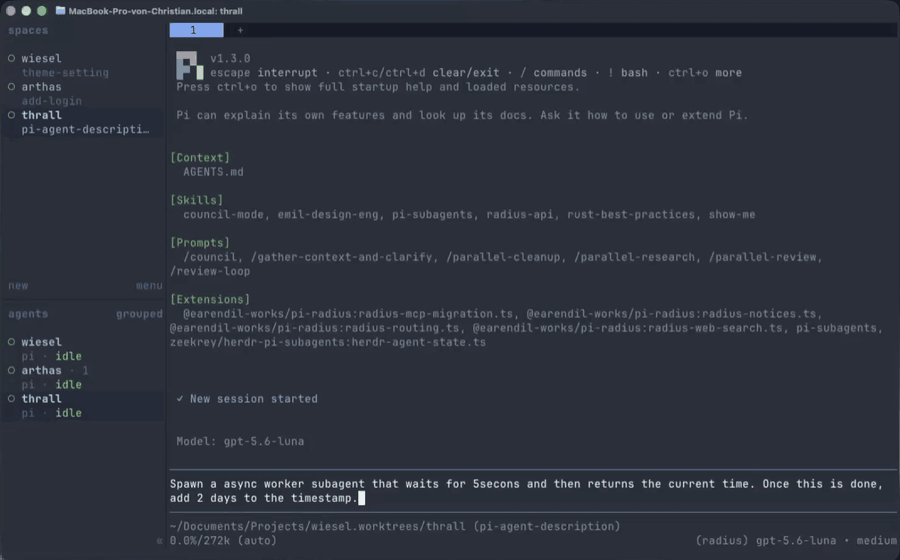

# herdr - pi-subagents-integration

herdr's Pi integration, with support for [pi-subagents](https://github.com/nicobailon/pi-subagents) background runs.

<p align="center">
  
</p>

<p align="center"><sub>The pane stays <b>working</b> with <code>⏳ 1 subagent</code> while the child runs, and only goes idle once the parent is really done.</sub></p>

---

## Install

Swap herdr's official Pi integration for this one:

```sh
herdr integration uninstall pi
pi install git:github.com/zeekrey/herdr-pi-subagents
```

Restart Pi inside herdr. That's it.

### Show the subagent label (optional)

pi-subagents reports a label like `⏳ 2 subagents (worker, reviewer)`, but herdr's default sidebar hides it. Add `state_text` to the agent rows in `~/.config/herdr/config.toml`:

```toml
[ui.sidebar.agents]
rows = [
  ["state_icon", "machine", "workspace", "tab"],
  ["agent", "state_text"],
]
```

Then run `herdr server reload-config`. While subagents run, the Pi entry shows the label; otherwise it shows the normal `idle`, `done` or `working`. This only affects the expanded sidebar.

## The problem

With the official integration, you ask Pi to fan out some background subagents, and herdr immediately says **done** 🔔. But nothing is done: the subagents are still chewing away.

Why:

- herdr's extension only watches the parent's own turn: `agent_start` means working, `agent_settled` means idle.
- Launching a background subagent returns right away, so the parent's turn ends and the pane flips to idle. herdr sees a working → idle change you haven't looked at yet and calls it done.
- pi-subagents already sends a `herdr:busy` signal while background runs are active. herdr's extension just doesn't listen for it. pi-subagents even says so in its docs: *"Herdr's Pi integration does not consume `herdr:busy` yet."*

This package is the official extension plus that missing listener. The pane stays **working** while any subagent runs. When the last one finishes, it waits a moment for Pi to pick the results back up, so you don't get a fake done in between.
